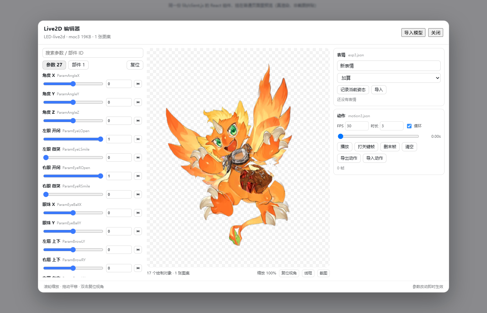
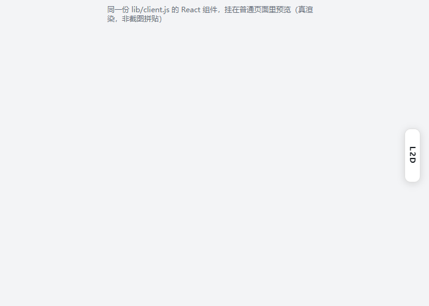

# dsh-live2d-editor

DSH Web GUI 里的 **Live2D 编辑器**：窗口右缘中部一枚竖排 `L2D` 标签，点开是一整块面板 —— 左边参数滑块、中间真·WebGL 模型视口、右边表情与动作。

不是示意图、不是 CSS 假变形：视口直接用 Live2D 官方的 **Cubism Core** 驱动 `moc3`，每一帧从 Core 取 `drawables.vertexPositions` 上传 GPU，和 Cubism SDK 走同一条数据链。



## 能做什么

| 区域 | 功能 |
| --- | --- |
| 视口 | 滚轮缩放、拖动平移、双击复位、线框模式、PNG 截图 |
| 参数 | 全部参数滑块 + 数值输入（名字取 `cdi3.json` 的中文名）、单参数复位、全部复位、搜索 |
| 部件 | 部件不透明度（`Parts`） |
| 表情 | 记录当前姿态 → 列表、应用、删除、导入/导出标准 `.exp3.json`（加算/乘算/覆盖） |
| 动作 | 时间轴打关键帧、播放/循环、导入/导出标准 `.motion3.json` |
| 模型 | 内置 LED v16；也能「导入模型」同时选中 `.model3.json` + `.moc3` + 图集（+ `cdi3.json`）换成任何 Cubism 3/4/5 模型 |

表情与动作按模型名存在 `localStorage`，刷新还在。`Esc` 关闭面板。

收起来时就是右缘这么一枚竖排标签（`top:42%`，让开滚动条与右下角的桌宠）：




## 安装

需要 DSH `0.2.1-rc.5` 以上、`0.3.0` 以下（见 `engines.dsh`），Node.js 22 以上。

**从 GitHub 装**（`lib/client.js` 已作为构建产物提交，走 git 装不需要任何构建授权）：

```powershell
dsh plugin --profile desktop add github:TEKARAHikari/dsh-live2d-editor
```

也可以让 Agent 代劳：`plugin_manager action=install_bundle target=github:TEKARAHikari/dsh-live2d-editor`。

**从本地目录装**（clone 或解压后的目录）：

```powershell
plugin_manager action=install_bundle target=D:\path\to\dsh-live2d-editor
```

**离线包**：`dist/` 里的 `dsh-live2d-editor-0.1.0.zip`（含 `INSTALL.md`）或 `.tgz`。

装完重启 DSH、刷新页面，窗口右缘中部出现竖排 `L2D` 标签。

## 开发

```bash
npm run build        # assets → build/model-assets.mjs；src → lib/client.js
npm test             # node:test，34 例（纯逻辑 + bundle 结构 + React 桩渲染）
npm run test:browser # 无头 Edge：真渲染（覆盖率/顶点真的动了）+ 真交互（拖滑块/存表情/导出）
npm run pack:check   # 包体检（npm pack 清单 + 产物标记）
npm run fetch:vendor # 只测试用，下载 React UMD 到 build/vendor
node scripts/make-dist.mjs  # 出 dist/*.tgz 与 dist/*.zip
```

测试要在源码目录里跑：`test/` 引的是 `src/*.mjs`，发布包里不带这两个目录。

`lib/client.js` 是**生成物**（`scripts/build-client.mjs`）：把 Cubism Core 源码、内置模型、`src/*.mjs` 纯逻辑、`src/viewport.js` 渲染器、`src/ui.js` 面板按顺序内联进一个 ModuleLoader bundle。改源码后必须重新 `npm run build`，`npm test` 会用 `--check` 抓不同步。

### 目录

```
index.js                宿主半边：只做产物体检，绝不抛错
src/params.mjs          参数/部件行、夹值、快照、复位
src/expression.mjs      exp3.json 读写（Blend: Add / Multiply / Overwrite）
src/motion.mjs          motion3.json 读写（Segments 布局对齐官方解析器）
src/manifest.mjs        model3.json / moc3 / 图集清单归一化
src/viewport.js         WebGL 视口：多图集、renderOrders 排序、缩放平移、线框
src/ui.js               React 面板 + 样式 + 导入导出交互
scripts/build-*.mjs     构建；verify-*.mjs 无头浏览器验证；make-dist.mjs 出包
assets/                 内置模型源文件 + Cubism Core（Redistributable Code）
build/, lib/            生成物（build/ 不进包）
```

## 实现上值得记一笔的两处坑

1. **Core 必须用间接 eval**：`(0, eval)(CORE_SRC)` 在全局作用域执行，emscripten 才正常初始化；`<script>` 注入会半初始化。
2. **eval 完那一拍 Core 还没就绪**：`Moc.fromArrayBuffer` 会报 `Cannot read properties of undefined (reading 'apply')`。面板里用 `Version.csmGetVersion()` 轮询到运行时起来再建模型（25ms 一次，最多 5 秒）。

## 已知限制

- **剪裁遮罩（Clipping Mask）未实现**：带遮罩的对象会整块画出来，面板底部提示数量。LED 模型没有遮罩。
- 混合模式按直通 alpha 画，不区分 Multiply/Additive。
- 导入 `.motion3.json` 时 Bezier 段按 8 点采样成折线，再导出就是线性段（画面一致，曲线信息会丢）。
- 不写 `.cmo3`：那是 Cubism Editor 的私有工程容器（`CAFF` 头），第三方写回有毁工程的风险。改工程请用 Cubism Editor；这个面板负责「调参数、存表情、做小动作、导标准文件」。

## 许可

- 本仓库代码：MIT（见 `LICENSE`）。
- `assets/live2dcubismcore.min.js`（内联进 `lib/client.js`）：Live2D Cubism Core，按 Live2D Proprietary Software License Agreement 的 “Redistributable Code” 条款随包分发，见 `NOTICE`。
- `assets/LED-live2d/*`：本机自有素材。
